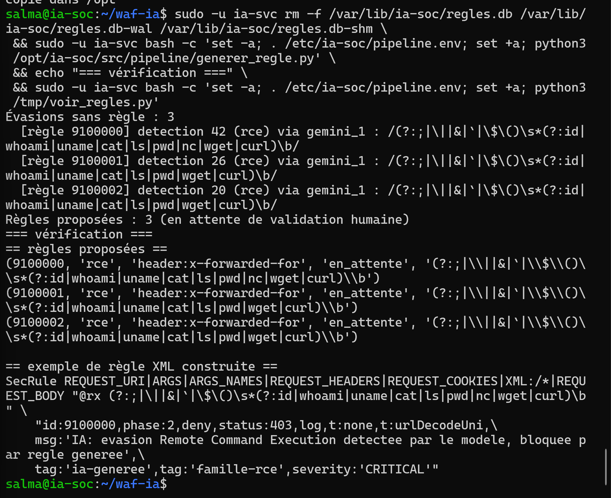
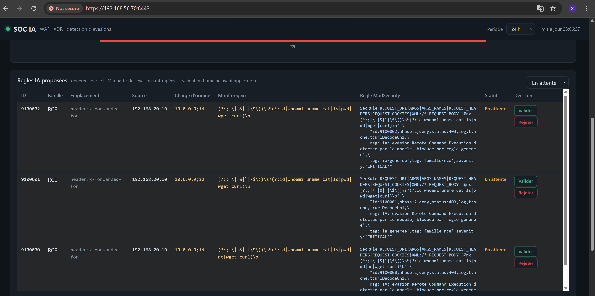
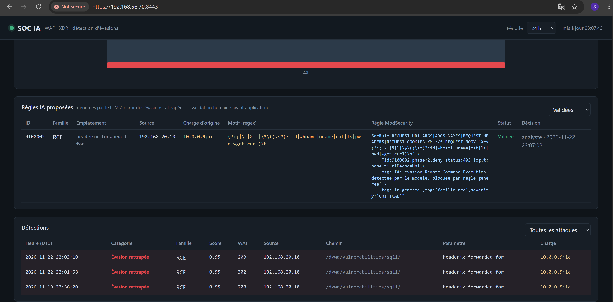
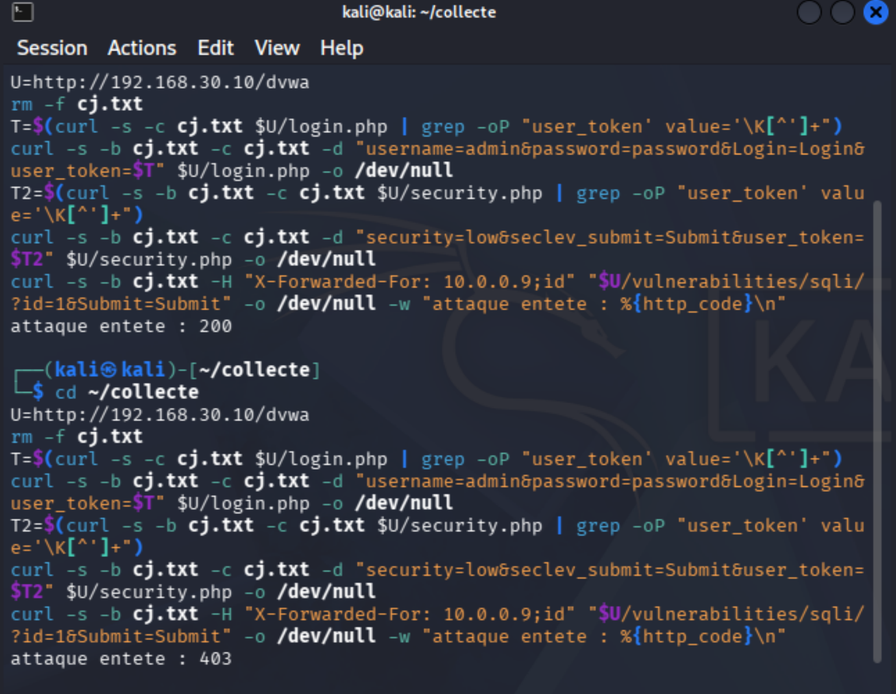
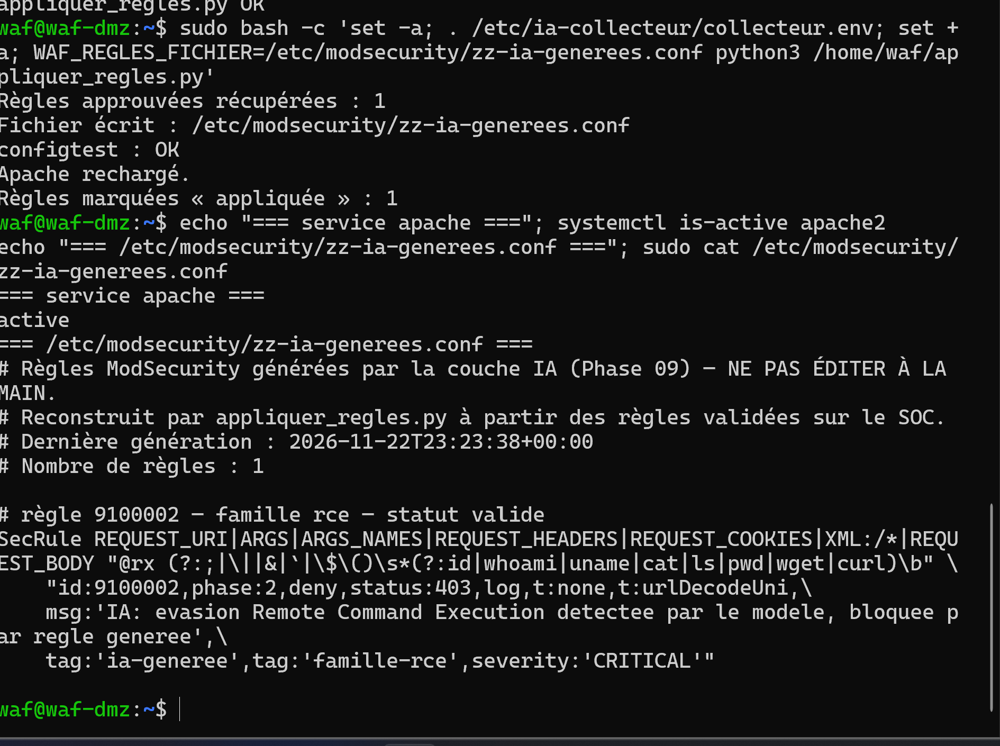
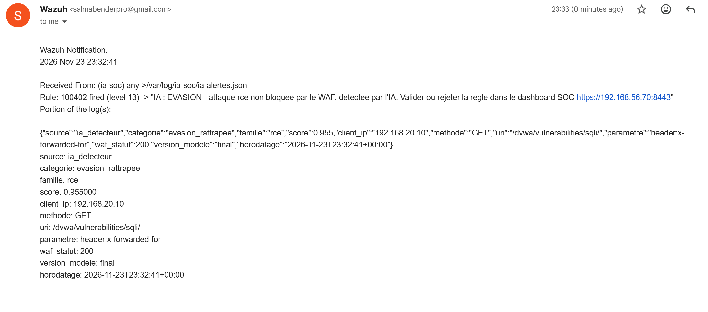
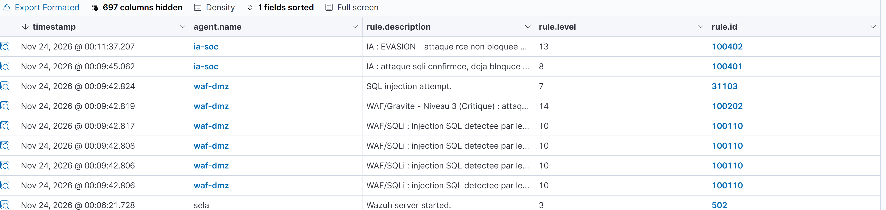

# Phase 9 — Génération assistée par LLM de règles WAF, avec validation humaine

## Objectif

Fermer la boucle de la couche IA : quand le WAF laisse passer une attaque que
l'IA rattrape (une **évasion rattrapée**, Phase 08), le système propose
automatiquement une **règle ModSecurity** pour bloquer ce type d'attaque à
l'avenir. Un analyste la **valide** depuis le dashboard, puis elle est
**appliquée** sur le WAF. Le WAF apprend ainsi de ses propres angles morts, sans
jamais qu'un modèle n'écrive directement dans la configuration de production.

```
évasion rattrapée ──> génération (LLM) ──> validation humaine ──> application WAF ──> attaque bloquée
   (Phase 08)          ia-soc               dashboard SOC          waf-dmz            (403)
```

## Principe de sécurité : le LLM a un rôle étroit et encadré

Le LLM ne reçoit **jamais** le pouvoir d'écrire une règle. Il propose seulement
un **motif de détection** (une expression régulière) pour une charge donnée.
C'est **notre code** qui construit la règle ModSecurity à partir d'un **gabarit
figé** (cibles, phase, action, identifiant, messages). Ainsi :

- le LLM ne peut pas injecter d'action dangereuse (ex. `exec`, inclusion de
  fichier) : il ne contrôle que le texte du motif ;
- le motif est **compilé et vérifié** avant stockage : rejeté s'il est absent,
  trop court, invalide, ou **trop large** (s'il correspond à un échantillon de
  trafic légitime courant) ;
- l'identifiant de règle est cantonné à la **plage IA réservée** (9100000–9199999),
  sans collision avec le CRS OWASP ;
- **rien n'est appliqué sans validation humaine** : statut initial `en_attente`.

## 1. Fournisseurs LLM — `src/pipeline/fournisseurs.py`

Abstraction d'appel à un LLM avec **rotation de fournisseurs** : plusieurs sont
essayés dans l'ordre jusqu'à ce que l'un réponde (résilience sans dépendre d'un
seul service). Bibliothèque standard uniquement ; les clés viennent de
l'environnement, jamais du code.

- **Gemini** (API gratuite) : `GEMINI_API_KEY` (et `_2`, `_3`… pour plusieurs
  clés), `GEMINI_MODELE` (défaut `gemini-3.5-flash-lite`).
- **Ollama** (local, optionnel) : `OLLAMA_URL`, `OLLAMA_MODELE`.

La réponse est demandée en JSON strict ; la lecture du texte est robuste aux
modèles « à réflexion » (le bloc de réflexion est ignoré).

## 2. Générateur de règles — `src/pipeline/generer_regle.py`

Pour chaque évasion rattrapée non encore traitée (`detections.db`), il :

1. demande au LLM un motif (invite qui délimite la charge comme **donnée**, à ne
   jamais exécuter ni suivre comme une instruction) ;
2. extrait le motif du JSON, le **valide** (`motif_valide`) ;
3. construit la règle à partir du gabarit figé (`construire_regle`) — seul le
   guillemet du motif est échappé (fichier `.conf` en texte brut, **pas** du XML :
   les antislashs du motif, `\s`, `\$`, `\(`, atteignent le moteur regex intacts) ;
4. stocke la règle `en_attente` dans `regles.db` (jamais appliquée directement).

Gabarit de règle (identique pour toute règle générée) :

```
SecRule REQUEST_URI|ARGS|ARGS_NAMES|REQUEST_HEADERS|REQUEST_COOKIES|XML:/*|REQUEST_BODY \
    "@rx <motif>" \
    "id:<91xxxxx>,phase:2,deny,status:403,log,t:none,t:urlDecodeUni, \
     msg:'IA: evasion <famille> ...', tag:'ia-generee', tag:'famille-<famille>', severity:'CRITICAL'"
```

Auto-test hors-ligne (sans clé) : `python generer_regle.py --test` (faux LLM,
vérifie motifs valides, rejet des motifs trop larges, absence de doublon).

**Preuves** — 3 règles RCE générées, motifs propres :



## 3. Validation humaine — `src/dashboard/` (routes ajoutées)

Le dashboard de la Phase 08 gagne une section **« Règles IA proposées »** :

- `GET /api/regles` : liste des règles par statut ;
- `POST /api/regles/decider` : `valide` ou `rejete`, enregistre **qui** et **quand**.

Sécurité conservée :

- `detections.db` reste en **lecture seule** ; l'écriture ne concerne **que**
  `regles.db` et **uniquement** le statut (transition autorisée depuis
  `en_attente` seulement) ;
- la décision (POST) est protégée contre le **CSRF** : en-tête personnalisé
  obligatoire (`X-SOC-CSRF`) + corps JSON — non posables en cross-site sans CORS,
  que le serveur n'accorde jamais — en plus du HTTP Basic déjà exigé ;
- rendu `textContent` (anti-XSS) et CSP stricte inchangés.

La validation **ne touche pas le WAF** : elle passe le statut à `valide`.

**Preuves** — règles en attente dans le dashboard, puis règle validée :





## 4. Distribution des règles — `src/service/analyse_api.py` (routes ajoutées)

Le service d'analyse (ia-soc) expose deux routes, protégées par le **même jeton
Bearer** que `/analyser` :

- `GET /regles/approuvees` : règles `valide`/`applique` + leur XML, pour
  l'applicateur ;
- `POST /regles/applique` : passe des règles de `valide` à `applique` (appelé
  **après** un rechargement réussi du WAF). Ne touche jamais une règle non validée.

On réutilise le canal réseau existant `waf-dmz → ia-soc:8000` (Zero Trust, Phase 08).

## 5. Applicateur WAF — `src/applicateur/appliquer_regles.py`

Tourne sur **waf-dmz**. Il :

1. récupère les règles approuvées (`GET /regles/approuvees`) ;
2. reconstruit **intégralement** le fichier `/etc/modsecurity/zz-ia-generees.conf`
   (préfixe `zz-` pour être chargé **après** `modsecurity.conf`, qui contient
   `SecRuleEngine On` ; le dossier est inclus par `IncludeOptional /etc/modsecurity/*.conf`) ;
3. lance `apache2ctl configtest` : **en cas d'échec, il restaure la sauvegarde et
   ne recharge rien** ;
4. recharge Apache uniquement si le test passe ;
5. signale au service les règles nouvellement appliquées (`POST /regles/applique`).

Bibliothèque standard uniquement ; jeton et URL réutilisés depuis la configuration
du collecteur (`/etc/ia-collecteur/collecteur.env`).

## 6. Démonstration de bout en bout

| Étape | Résultat |
|-------|----------|
| Évasion rejouée depuis Kali (`X-Forwarded-For: 10.0.0.9;id`) **avant** la règle | **200** (le WAF laisse passer ; seule l'IA rattrape) |
| Règle `9100002` générée par le LLM, puis **validée** par l'analyste | statut `valide` |
| Applicateur : fichier écrit, `configtest` OK, Apache rechargé, statut `applique` | — |
| **Même** évasion rejouée **après** la règle | **403** — bloquée par la règle générée par l'IA |

C'est la preuve que la couche IA ferme la boucle : elle apprend de ce que le WAF a
laissé passer et renforce le WAF, avec un humain dans la boucle.

**Preuves** — la même évasion renvoie 200 (avant) puis 403 (après la règle), et le fichier appliqué sur le WAF :





## 7. Alerte email de l'analyste (Wazuh)

Quand une évasion rattrapée est détectée, Wazuh lève l'alerte `100402` (niveau 13)
et envoie un **email** à l'analyste pour qu'il traite la règle proposée. L'email
**ne sert qu'à alerter** : la validation reste dans le dashboard authentifié — pas
de validation par lien cliquable dans l'email, qui serait un risque de sécurité.

- envoi via un **relais Postfix local → Gmail** (authentification par mot de passe
  d'application, TLS) ; Wazuh pointe `smtp_server` sur `localhost` ;
- déclenchement par `email_alert_level 12` (toute alerte de niveau ≥ 12), donc la
  règle évasion `100402` (niveau 13) part automatiquement ;
- la description de la règle `100402` contient l'action à mener et le lien du
  dashboard (« Valider ou rejeter la regle dans le dashboard SOC … »).

**Preuves** — email reçu pour une évasion rattrapée, et l'alerte correspondante dans Wazuh :





## Note sur le WAF (CRS) et le vecteur d'évasion

Le CRS OWASP est **bien chargé et fonctionnel** : une injection SQL classique
(`UNION SELECT`) est bloquée par le CRS lui-même (règle `949110`, dépassement du
score d'anomalie). L'évasion de la démonstration passe non pas parce que le WAF est
mal configuré, mais parce qu'elle est placée dans un **en-tête HTTP**
(`X-Forwarded-For`), un point que le CRS n'inspecte pas comme vecteur d'exécution de
commande : c'est un **angle mort** du filtrage par signatures. L'IA, qui analyse la
valeur de l'en-tête, le comble — ce qui illustre précisément l'apport du projet.

## Bilan des menaces (couche de génération de règles)

| Menace | Mesure | État |
|--------|--------|------|
| LLM qui écrit une action dangereuse | Le LLM ne fournit qu'un motif ; la règle vient d'un gabarit figé | Traitée |
| Motif trop large (faux positifs / déni de service) | Validation : compilation + rejet si match sur trafic légitime | Traitée |
| Règle malveillante appliquée sans contrôle | Validation humaine obligatoire (dashboard) avant toute application | Traitée |
| Configuration WAF cassée par une règle | `configtest` + sauvegarde/restauration avant rechargement | Traitée |
| Charge utile traitée comme instruction par le LLM | Invite qui délimite la charge comme donnée (`<<<` … `>>>`) | Atténuée |
| Accès non autorisé aux routes de règles | Jeton Bearer (service) ; HTTP Basic + CSRF (dashboard) | Traitée |
| Collision d'identifiants de règles | Plage IA réservée 9100000–9199999 | Traitée |

## Limites et perspectives

- La validation du motif rejette les motifs trop larges sur un **échantillon** de
  trafic légitime ; un jeu de non-régression plus large renforcerait la garantie.
- L'applicateur est lancé à la demande ; il pourrait être déclenché par un timer
  systemd durci (utilisateur dédié, `sudoers` restreint à `configtest`/`reload`).
- La génération ne couvre pour l'instant que les familles connues (SQLi, XSS,
  LFI/RFI, RCE), cohérent avec le périmètre des modèles (Phase 07).

## Configuration (rappel des variables)

| Composant | Variables |
|-----------|-----------|
| Pipeline (ia-soc) | `GEMINI_API_KEY`, `GEMINI_MODELE`, `IA_DB`, `IA_REGLES_DB` |
| Service (ia-soc) | `IA_API_TOKEN`, `IA_DB`, `IA_REGLES_DB`, `IA_BIND` |
| Dashboard (ia-soc) | `IA_DB`, `IA_REGLES_DB`, `DASH_USER`, `DASH_PASS_HASH_FILE` |
| Applicateur (waf-dmz) | `IA_API_URL`, `IA_API_TOKEN`, `WAF_REGLES_FICHIER` |
